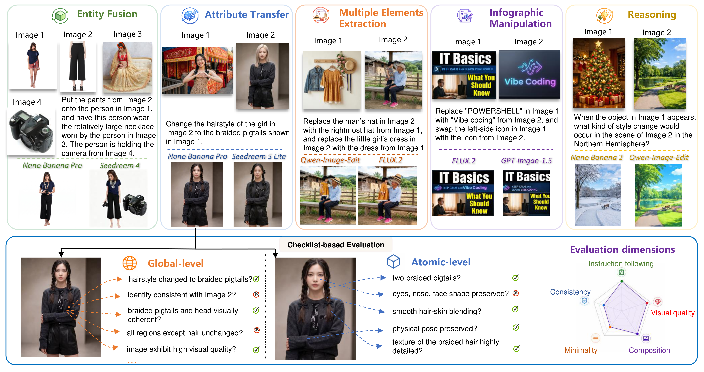

<h1 align="center">MDMR-Bench: A Multi-Dimensional Benchmark for Multi-Reference Image Generation</h1>

<p align="center">
  <a href="https://arxiv.org/abs/2610.32459v1"></a>
  <a href="https://github.com/LHRYANG/MDMR-Bench"></a>
  <a href="huggingface/README.md"></a>
</p>

<p align="center">
  Official codebase for MDMR-Bench, including inference, checklist-based evaluation, and score aggregation.
</p>

This repository is the official implementation of the following paper:

> **MDMR-Bench: A Multi-Dimensional Benchmark for Multi-Reference Image Generation**  
> Bowen Zheng<sup>1*</sup>, Jintao Lin<sup>2*</sup>, ChangHeng Yi<sup>1</sup>, Haoran Yang<sup>3,&#9993;</sup>, Binxiao Huang<sup>3</sup>, Chenyang Lei<sup>3</sup>, Rui Liu<sup>3</sup>, Xihui Liu<sup>2,&#9993;</sup>  
> *<sup>1</sup>Nanjing University, <sup>2</sup>The University of Hong Kong, <sup>3</sup>Huawei Research*  
> *NeurIPS, 2026*  
> <sup>*</sup>Equal contribution. &#9993;Correspondence: `eurekayang96@outlook.com`, `xihuiliu@eee.hku.hk`

---

## 🔥 Highlights

- Multi-dimensional benchmark for multi-reference image generation.
- Five evaluation dimensions: `following`, `consistency`, `composition`, `minimality`, `quality`.
- Provides both global-level and atomic-level checklist diagnostics.

## 📚 Table of Contents

- [🖼️ Visual Overview](#visual-overview)
- [📌 Quick Start](#quick-start)
- [📝 Abstract](#abstract)
- [🏆 Benchmark Tables](#benchmark-tables)
- [📦 Dataset Layout](#dataset-layout)
- [🛠️ Setup](#setup)
- [🧪 Inference](#inference)
- [🤖 Gemini Evaluation](#gemini-evaluation)
- [📊 Score Aggregation](#score-aggregation)
- [✅ Release Checklist](#release-checklist)
- [📚 Citation](#citation)

<a id="visual-overview"></a>
## 🖼️ Visual Overview




<a id="quick-start"></a>
## 📌 Quick Start

Pipeline:

1. Install Python `3.11.11` and dependencies.
2. Run multi-reference image generation (`src/inference`).
3. Evaluate outputs with Gemini (`scripts/evaluate_outputs.py`).
4. Aggregate benchmark scores (`scripts/aggregate_scores.py`).

<a id="abstract"></a>
## 📝 Abstract

Image generation models have rapidly advanced, with many models now supporting generation conditioned on multiple reference images and textual instructions. Such models enable a wide range of applications, including entity fusion and attribute transfer across images. However, existing benchmarks for multi-reference image generation rely on limited evaluation dimensions and fail to capture the diverse challenges of the task. To address this limitation, we propose MDMR-Bench, a Multi-Dimensional benchmark for Multi-Reference image generation. MDMR-Bench is designed based on realistic usage scenarios and consists of multiple evaluation subsets spanning diverse dimensions of multi-reference image generation, including (1) common entity fusion and attribute transfer, (2) multi-element extraction from a single image, (3) infographic manipulation, and (4) visual reasoning-intensive generation. This design enables systematic analysis of model capabilities and failure modes across different challenge dimensions. Furthermore, to achieve more reliable and interpretable evaluation, we introduce a checklist-based evaluation protocol that decomposes generation quality into fine-grained evaluation aspects. Instead of relying solely on holistic scoring, our framework uses structured checklists composed of both global-level and atomic-level queries, enabling more diagnostic assessment of model performance.

<a id="benchmark-tables"></a>
## 🏆 Benchmark Tables

### Table 1. Comparison with other benchmarks

`✔`: dedicated coverage, `△`: partial or incidental coverage, `✗`: no coverage.

| Benchmark | Size | Entity Fusion | Multi-Element Extraction | Attribute Transfer | Infographic Manip. | Visual Reasoning | Global Eval. | Atomic Eval. | Metrics |
| --- | ---: | :---: | :---: | :---: | :---: | :---: | :---: | :---: | --- |
| DreamBooth | 75 | ✔ | ✗ | △ | ✗ | ✗ | ✔ | ✗ | CLIP Fidelity |
| DreamOmni2 | 319 | ✔ | ✗ | ✔ | △ | ✗ | ✔ | ✗ | Score-based |
| MICo-Bench | 897 | ✔ | ✔ | ✗ | ✗ | ✗ | ✔ | ✗ | Score-based |
| MultiBanana | 3769 | ✔ | ✗ | ✔ | △ | ✗ | ✔ | ✗ | Score-based |
| VTEdit-Bench | 24220 | ✔ | ✗ | △ | ✗ | ✗ | ✔ | ✗ | Score-based |
| MDMR-Bench (Ours) | 2390 | ✔ | ✔ | ✔ | ✔ | ✔ | ✔ | ✔ | Checklist-based |

### Table 2. Main results on MDMR-Bench

<table>
  <thead>
    <tr>
      <th align="left">Model</th>
      <th>Following</th>
      <th>Consistency</th>
      <th>Composition</th>
      <th>Minimality</th>
      <th>Quality</th>
      <th>Overall</th>
    </tr>
  </thead>
  <tbody>
    <tr><td colspan="7" align="center"><strong>Closed-source Models</strong></td></tr>
    <tr><td align="left">GPT-Image-2</td><td>90.1</td><td>87.4</td><td>90.8</td><td>84.5</td><td>93.2</td><td>88.8</td></tr>
    <tr><td align="left">Nano Banana Pro</td><td>91.2</td><td>84.6</td><td>83.9</td><td>80.4</td><td>87.0</td><td>85.1</td></tr>
    <tr><td align="left">Nano Banana 2</td><td>88.0</td><td>82.0</td><td>81.2</td><td>72.1</td><td>84.1</td><td>81.2</td></tr>
    <tr><td align="left">Seedream 5.0</td><td>86.2</td><td>74.0</td><td>81.1</td><td>71.5</td><td>84.3</td><td>78.8</td></tr>
    <tr><td align="left">Seedream 4.0</td><td>85.3</td><td>73.4</td><td>80.7</td><td>69.7</td><td>82.8</td><td>77.8</td></tr>
    <tr><td align="left">GPT-Image-1.5</td><td>90.3</td><td>72.1</td><td>85.9</td><td>56.8</td><td>85.6</td><td>77.5</td></tr>
    <tr><td colspan="7" align="center"><strong>Open-source Models</strong></td></tr>
    <tr><td align="left">FLUX.2</td><td>46.5</td><td>50.0</td><td>51.1</td><td>51.5</td><td>63.8</td><td>51.3</td></tr>
    <tr><td align="left">Qwen-Image-Edit</td><td>47.7</td><td>46.4</td><td>51.5</td><td>49.1</td><td>61.3</td><td>49.9</td></tr>
    <tr><td align="left">BAGEL</td><td>37.3</td><td>40.7</td><td>34.7</td><td>58.1</td><td>39.8</td><td>41.9</td></tr>
    <tr><td align="left">DreamOmni2</td><td>43.9</td><td>31.0</td><td>49.8</td><td>33.1</td><td>63.0</td><td>41.9</td></tr>
    <tr><td align="left">OmniGen2</td><td>30.1</td><td>22.2</td><td>34.6</td><td>21.1</td><td>42.1</td><td>28.6</td></tr>
  </tbody>
</table>

### Table 3. Performance across task types

<table>
  <thead>
    <tr>
      <th align="left">Model</th>
      <th>Entity Fusion</th>
      <th>Multi-Element Extraction</th>
      <th>Visual Reasoning</th>
      <th>Attribute Transfer</th>
      <th>Infographic Manip.</th>
      <th>Overall</th>
    </tr>
  </thead>
  <tbody>
    <tr><td colspan="7" align="center"><strong>Closed-source Models</strong></td></tr>
    <tr><td align="left">GPT-Image-2</td><td>91.5</td><td>89.6</td><td>94.8</td><td>90.2</td><td>87.6</td><td>88.7</td></tr>
    <tr><td align="left">Nano Banana Pro</td><td>84.9</td><td>87.2</td><td>85.6</td><td>83.3</td><td>84.7</td><td>85.1</td></tr>
    <tr><td align="left">Nano Banana 2</td><td>82.5</td><td>85.6</td><td>75.9</td><td>82.4</td><td>79.8</td><td>81.2</td></tr>
    <tr><td align="left">Seedream 5.0</td><td>77.9</td><td>81.3</td><td>83.6</td><td>78.6</td><td>72.5</td><td>78.8</td></tr>
    <tr><td align="left">Seedream 4.0</td><td>77.9</td><td>83.1</td><td>83.7</td><td>76.6</td><td>67.9</td><td>77.8</td></tr>
    <tr><td align="left">GPT-Image-1.5</td><td>81.8</td><td>78.4</td><td>76.5</td><td>82.3</td><td>68.5</td><td>77.5</td></tr>
    <tr><td colspan="7" align="center"><strong>Open-source Models</strong></td></tr>
    <tr><td align="left">FLUX.2</td><td>73.5</td><td>54.1</td><td>36.7</td><td>47.9</td><td>44.0</td><td>51.3</td></tr>
    <tr><td align="left">Qwen-Image-Edit</td><td>66.9</td><td>55.3</td><td>44.3</td><td>44.1</td><td>39.2</td><td>49.9</td></tr>
    <tr><td align="left">BAGEL</td><td>41.5</td><td>39.9</td><td>52.1</td><td>35.6</td><td>40.5</td><td>41.9</td></tr>
    <tr><td align="left">DreamOmni2</td><td>50.0</td><td>44.2</td><td>34.2</td><td>43.1</td><td>38.0</td><td>41.9</td></tr>
    <tr><td align="left">OmniGen2</td><td>44.9</td><td>29.0</td><td>22.7</td><td>26.9</td><td>19.7</td><td>28.6</td></tr>
  </tbody>
</table>

<a id="dataset-layout"></a>
## 📦 Dataset Layout

Inference reads one JSONL manifest, with one sample per line.

```text
MDMR-bench/
  mdmr.jsonl
  fusion/
    four_images/
      F4_0001/
        F4_0001.json
        F4_0001_img1.jpg
        F4_0001_img2.jpg
        ...
  multiple_extraction/
    ME_0001/
      ME_0001.json
      ME_0001_img1.jpg
      ...
```

Default task groups:

- `fusion`
- `style_transfer`
- `text_logo`
- `multiple_extraction`
- `reasoning`

JSONL record schema (expanded below for readability; each record occupies one line in the file):

```json
{
  "sample_id": "<sample_id>",
  "task_id": "<task_name>",
  "subtask_id": "<subtask_name>",
  "instruction_zh": "<Chinese instruction>",
  "instruction_en": "<English instruction>",
  "output_width": 1024,
  "output_height": 1024,
  "image_paths": [
    "fusion/two_images/<sample_id>/<sample_id>_img1.jpg",
    "fusion/two_images/<sample_id>/<sample_id>_img2.jpg"
  ],
  "checklist": {
    "following": ["..."],
    "consistency": ["..."],
    "composition": ["..."],
    "minimality": ["..."],
    "quality": ["..."]
  }
}
```

`image_paths` are relative to `--image_root`, which defaults to the manifest's parent directory. List order defines Image 1, Image 2, etc.

All 2,390 samples contain non-empty `instruction_en`. Inference uses only this English instruction.

<a id="setup"></a>
## 🛠️ Setup

Use Python `3.11.11`.

Linux/macOS:

```bash
python -m venv .venv
source .venv/bin/activate
python -m pip install --upgrade pip
pip install -r requirements.txt
```

Windows PowerShell:

```powershell
python -m venv .venv
.\.venv\Scripts\Activate.ps1
python -m pip install --upgrade pip
pip install -r requirements.txt
```

Supported inference models:

- `flux2`: `black-forest-labs/FLUX.2-dev`
- `qwen`: `Qwen/Qwen-Image-Edit-2511`

If required pipelines are missing, install recent source builds:

```bash
pip install --upgrade git+https://github.com/huggingface/diffusers.git
pip install --upgrade git+https://github.com/huggingface/transformers.git
pip install --upgrade accelerate sentencepiece safetensors
```

If model access requires authentication:

```bash
export HF_TOKEN=<your_huggingface_token>
```

PowerShell:

```powershell
$env:HF_TOKEN="<your_huggingface_token>"
```

<a id="inference"></a>
## 🧪 Inference

Entry point: `src/inference/inference.py`

Activate the Python environment with the model dependencies, then run the following commands from the repository root:

```bash
cd MDMR-Bench
```

The examples assume the `MDMR-Bench` code repository contains a benchmark dataset directory also named `MDMR-Bench`. The outer directory is the repository root; the inner directory holds `mdmr.jsonl` and the input images. All commands below run from the outer directory. Adjust paths to your local layout without renaming existing directories:

```text
workspace/
  MDMR-Bench/
    README.md
    scripts/
    src/
    MDMR-Bench/
      mdmr.jsonl
      fusion/
      style_transfer/
      text_logo/
      reasoning/
      multiple_extraction/
    outputs/
```

`MDMR-bench/mdmr.jsonl` contains 2,390 samples. Image paths are resolved relative to `MDMR-bench` automatically, so `--image_root` can be omitted. If your data is elsewhere, replace `--manifest` and optionally specify `--image_root`.

Inference accepts only these five options (plus `--help`):

| Option | Required | Meaning |
|---|---|---|
| `--model` | Yes | One model: `flux2` or `qwen` |
| `--output_dir` | Yes | Exact destination; no model directory is automatically added |
| `--manifest` | Yes | Benchmark JSONL |
| `--image_root` | No | Root for relative input image paths; defaults to the manifest parent |
| `--model_path` | No | Local Diffusers weights directory; defaults to the selected model's Hugging Face ID |

Relative CLI paths are resolved from the current working directory. Run the examples from the repository root. Choose different output directories for different models or checkpoints; the script does not track which model produced existing images.

### Full dataset with default Hugging Face weights

Run Flux2 on all manifest samples:

```bash
python src/inference/inference.py \
  --model flux2 \
  --manifest MDMR-bench/mdmr.jsonl \
  --output_dir outputs/flux2
```

Run Qwen separately, with a different user-selected directory:

```bash
python src/inference/inference.py \
  --model qwen \
  --manifest MDMR-bench/mdmr.jsonl \
  --output_dir outputs/qwen
```

The `flux2` and `qwen` directory names in these examples are chosen explicitly by the user, not appended by the script. Any output directory name can be used.

### Local weights and a separate image root

Replace `/path/to/FLUX.2-dev` with the actual model directory:

```bash
python src/inference/inference.py \
  --manifest ../MDMR-bench/mdmr.jsonl \
  --model flux2 \
  --image_root MDMR-bench \
  --model_path /path/to/FLUX.2-dev \
  --output_dir outputs/flux2-local
```

### Saved results and resume behavior

```text
<output_dir>/
  fusion/
    F2_0001/
      F2_0001_result.jpg
```

The path is `output_dir / task_id / sample_id / sample_id_result.jpg`. 

<a id="gemini-evaluation"></a>
## 🤖 Gemini Evaluation

`scripts/evaluate_outputs.py` reads instructions, ordered `image_paths`, and checklists from the JSONL manifest. Set `--benchmark-output-root` to the exact `--output_dir` used for inference: it looks for `TASK/SAMPLE/SAMPLE_result.jpg` directly.


```bash
python -m pip install requests Pillow
```

For Yunwu, set its API key and Gemini-native endpoint (not an OpenAI chat-completions URL):

```bash
export GEMINI_API_KEY="<your_api_key>"
export GEMINI_BASE_URL="<your_url>"
```


Evaluate `flux2` outputs:

```bash
python scripts/evaluate_outputs.py \
  --manifest MDMR-bench/mdmr.jsonl \
  --benchmark-output-root outputs/flux2 \
  --num-processes 8
```

<a id="score-aggregation"></a>
## 📊 Score Aggregation

Aggregate scores from the model's results directory (`--benchmark-root` refers to results, not the dataset):

```bash
python scripts/aggregate_scores.py \
  --benchmark-root outputs/flux2
```

For Qwen, replace `outputs/flux2` with `outputs/qwen`. Summaries are saved inside the same results directory:

```text
outputs/flux2/analysis/
  per_case.jsonl
  by_directory.json
  by_directory.csv
  balanced_summary.json
  balanced_summary.csv
```

- **Primary score:** `balanced_summary.json` -> `benchmark.score.overall` (0–1), averaging cases within subtasks, subtasks within tasks, then tasks. `multiple_extraction` skips the subtask layer.
- `per_case.jsonl` contains individual scores; `by_directory.*` contains direct averages for reference.
- Only available scores are included. Re-run aggregation after evaluation finishes to update the summaries.


<a id="citation"></a>
## 📚 Citation

<details>
<summary><strong>BibTeX</strong> (click to expand)</summary>

```bibtex
@misc{zheng2026mdmrbench,
  title={MDMR-Bench: A Multi-Dimensional Benchmark for Multi-Reference Image Generation},
  author={Zheng, Bowen and Lin, Jintao and Yi, ChangHeng and Yang, Haoran and Huang, Binxiao and Lei, Chenyang and Liu, Rui and Liu, Xihui},
  year={2026},
  note={Preprint}
}
```

</details>
